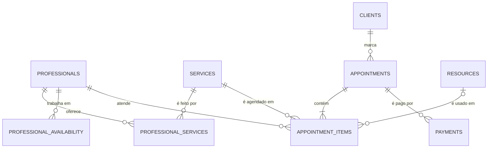

# Dicionário de dados — Beleza & Arte

Este documento explica **cada tabela e cada campo** do banco de dados: para que serve e como é usado no sistema.

O banco fica no **Supabase**, e as tabelas são criadas e alteradas direto nele. Se este documento e o Supabase discordarem, o Supabase é que vale — e este documento deve ser corrigido.

---

## Sumário

1. [Visão geral](#1-visão-geral)
2. [Como ler as tabelas deste documento](#2-como-ler-as-tabelas-deste-documento)
3. [Tabelas](#3-tabelas)
   - [professionals](#professionals--profissionais) · [clients](#clients--clientes) · [services](#services--serviços) · [professional_services](#professional_services--serviços-de-cada-profissional) · [professional_availability](#professional_availability--horário-de-trabalho) · [resources](#resources--recursos-do-salão) · [appointments](#appointments--agendamentos) · [appointment_items](#appointment_items--itens-do-agendamento) · [payments](#payments--pagamentos)
4. [Regras de negócio que ficam no código](#4-regras-de-negócio-que-ficam-no-código)
5. [Como alterar o banco](#5-como-alterar-o-banco)

---

## 1. Visão geral



**A ideia central:** um **agendamento** (`appointments`) é a *visita* do cliente ao salão. Numa mesma visita o cliente pode fazer vários serviços — por exemplo, mechas com a Anna às 14h e manicure com a Camila às 16h. Cada serviço da visita é um **item** (`appointment_items`), com seu próprio profissional, horário e preço. Isso reflete o fluxo de agendamento do front-end, que permite escolher vários serviços de uma vez.

**Como ler as linhas do diagrama:** `||--o{` significa "um para muitos" (um cliente tem zero ou muitos agendamentos). `||--|{` significa "um para um ou muitos" (todo agendamento tem pelo menos um item). `|o--o{` significa que o lado esquerdo é opcional (um item pode não usar nenhum recurso).

---

## 2. Como ler as tabelas deste documento

**Colunas:** *Campo* (nome no banco) · *Tipo* · *Obrig.* (✅ = não pode ficar vazio) · *Descrição*.

**Tipos usados:**

| Tipo | O que guarda | Exemplo |
|---|---|---|
| `INTEGER` | Número inteiro | `42` |
| `SMALLINT` | Número inteiro pequeno | `3` |
| `VARCHAR(n)` | Texto de até *n* caracteres | `'Anna'` |
| `CHAR(n)` | Texto de exatamente *n* caracteres | `'12345678901'` |
| `TEXT` | Texto sem limite de tamanho | observações longas |
| `NUMERIC(10,2)` | Número decimal exato, com 2 casas — usado para dinheiro | `150.00` |
| `BOOLEAN` | Verdadeiro ou falso | `true` |
| `DATE` | Só a data | `1990-05-20` |
| `TIME` | Só o horário | `09:00` |
| `TIMESTAMPTZ` | Data + hora + fuso horário (*timestamp with time zone*) | `2026-11-03 14:00-03` |

> **Por que `TIMESTAMPTZ` e não só `TIMESTAMP`?** O servidor do banco pode estar em outro fuso (o Supabase fica nos EUA, o Docker usa UTC). Guardando o fuso junto, 14h em Brasília é sempre 14h em Brasília, não importa onde o banco esteja.
>
> **Por que `NUMERIC` para dinheiro?** Tipos como `FLOAT` fazem arredondamentos (0,1 + 0,2 vira 0,30000000000000004). `NUMERIC` é exato, como deve ser com valores financeiros. No Java ele vira `BigDecimal`.

**Termos usados:**

| Termo | Significado |
|---|---|
| **PK** (*primary key*, chave primária) | O identificador único de cada linha. Em todas as tabelas é o campo `id`, gerado automaticamente pelo banco (1, 2, 3…) |
| **FK** (*foreign key*, chave estrangeira) | Um campo que aponta para o `id` de outra tabela. O banco **não deixa** apontar para algo que não existe |
| **Único** | O banco não deixa existir dois registros com o mesmo valor nesse campo |
| **Padrão** | Valor usado automaticamente quando nada é informado |
| **Valores permitidos** | O banco recusa qualquer valor fora da lista (regra `CHECK`) |

---

## 3. Tabelas

### `professionals` — Profissionais

Quem trabalha no salão: cabeleireiras, manicures, esteticistas etc. Também é quem **faz login** no sistema para ver a própria agenda. O dono do salão é um profissional com papel `ADMIN`.

| Campo | Tipo | Obrig. | Descrição |
|---|---|---|---|
| `id` | INTEGER | ✅ | PK. Gerado automaticamente |
| `name` | VARCHAR(120) | ✅ | Nome do profissional, como aparece para o cliente na hora de agendar |
| `cpf` | CHAR(11) | | CPF, só os números. **Único**. Pedido no cadastro do profissional no front |
| `email` | VARCHAR(160) | | E-mail de contato. **Único** |
| `phone` | VARCHAR(20) | | Telefone. É texto (e não número) porque pode ter DDD, zeros à esquerda, `+55` etc. |
| `specialty` | VARCHAR(80) | | Especialidade principal, para exibição (ex: "Cabeleireira"). Os serviços que ele faz de fato ficam em `professional_services` |
| `experience_years` | INTEGER | | Anos de experiência, exibido no perfil. Não pode ser negativo |
| `username` | VARCHAR(50) | | Usuário para login. **Único** |
| `password_hash` | VARCHAR(255) | | Senha **criptografada** (hash). A senha original nunca é guardada: no login, o sistema criptografa o que foi digitado e compara os dois hashes |
| `role` | VARCHAR(20) | ✅ | Papel no sistema. Valores permitidos: `ADMIN` (dono/gestor, vê tudo) e `PROFESSIONAL` (vê só a própria agenda). Padrão: `PROFESSIONAL` |
| `active` | BOOLEAN | ✅ | Se o profissional ainda trabalha no salão. Em vez de apagar quem saiu (o que quebraria o histórico de atendimentos), marca-se `false`. Padrão: `true` |
| `created_at` | TIMESTAMPTZ | ✅ | Data e hora do cadastro. Preenchido automaticamente. Serve para auditoria, ordenação e relatórios |
| `updated_at` | TIMESTAMPTZ | | Data e hora da última alteração do cadastro |

### `clients` — Clientes

Quem agenda os serviços. O cadastro é criado no próprio agendamento online (nome, telefone e e-mail), sem exigir senha — para ser simples também para quem tem pouca familiaridade com tecnologia, como prevê o relatório.

| Campo | Tipo | Obrig. | Descrição |
|---|---|---|---|
| `id` | INTEGER | ✅ | PK |
| `name` | VARCHAR(120) | ✅ | Nome do cliente |
| `phone` | VARCHAR(20) | ✅ | Telefone. **Único**: é o que identifica o cliente quando ele volta a agendar, e por onde chegam os lembretes |
| `email` | VARCHAR(160) | | E-mail, para confirmações e lembretes |
| `created_at` | TIMESTAMPTZ | ✅ | Data do cadastro ("cliente desde"). Automático |

Os campos são os mesmos da tela de cadastro do front-end (nome, telefone e e-mail).

O **histórico de serviços** do cliente não é um campo: ele é obtido juntando `appointments` + `appointment_items` desse cliente.

### `services` — Serviços

O catálogo do salão: o que pode ser agendado.

| Campo | Tipo | Obrig. | Descrição |
|---|---|---|---|
| `id` | INTEGER | ✅ | PK |
| `name` | VARCHAR(100) | ✅ | Nome do serviço (ex: "Mechas / Coloração"). **Único** |
| `description` | TEXT | | Descrição exibida ao cliente |
| `category` | VARCHAR(50) | | Agrupamento para a tela de agendamento e para relatórios (ex: "Cabelo", "Unhas", "Estética") |
| `duration_minutes` | INTEGER | ✅ | **Quanto tempo o serviço leva, em minutos** (ex: corte = 45, mechas = 180). Essencial para a agenda: é com ele que o sistema calcula o horário de término e bloqueia o profissional nesse intervalo. Tem que ser maior que zero |
| `price` | NUMERIC(10,2) | ✅ | Preço atual do serviço, em reais |
| `active` | BOOLEAN | ✅ | Se o serviço ainda é oferecido. Serviços desativados somem da tela de agendamento, mas continuam no histórico. Padrão: `true` |
| `created_at` | TIMESTAMPTZ | ✅ | Data do cadastro. Automático |

### `professional_services` — Serviços de cada profissional

Diz **quais serviços cada profissional sabe fazer**. É uma relação "muitos para muitos": a Anna faz mechas e escova; mechas é feito pela Anna e pela Sofia. É essa tabela que permite à tela de agendamento mostrar só os profissionais que fazem o serviço escolhido.

| Campo | Tipo | Obrig. | Descrição |
|---|---|---|---|
| `professional_id` | INTEGER | ✅ | FK → `professionals.id` |
| `service_id` | INTEGER | ✅ | FK → `services.id` |

A PK é o **par** dos dois campos, ou seja, o mesmo profissional não pode ser ligado duas vezes ao mesmo serviço. Se o profissional ou o serviço for apagado, a ligação é apagada junto (`ON DELETE CASCADE`).

### `professional_availability` — Horário de trabalho

Os dias e horários em que cada profissional atende. A agenda usa isso para oferecer ao cliente só horários dentro do expediente.

| Campo | Tipo | Obrig. | Descrição |
|---|---|---|---|
| `id` | INTEGER | ✅ | PK |
| `professional_id` | INTEGER | ✅ | FK → `professionals.id` |
| `weekday` | SMALLINT | ✅ | Dia da semana: `0` = domingo, `1` = segunda … `6` = sábado |
| `start_time` | TIME | ✅ | Início do expediente nesse dia (ex: `09:00`) |
| `end_time` | TIME | ✅ | Fim do expediente (ex: `18:00`). Tem que ser depois do início |

Para ter intervalo de almoço, basta cadastrar duas faixas no mesmo dia (ex: 09:00–12:00 e 13:00–18:00). O banco não deixa repetir a mesma faixa (mesmo profissional + dia + início).

### `resources` — Recursos do salão

Cadeiras, cabines e equipamentos. O relatório prevê o controle desses recursos para evitar, por exemplo, duas limpezas de pele ao mesmo tempo quando só existe uma cabine.

| Campo | Tipo | Obrig. | Descrição |
|---|---|---|---|
| `id` | INTEGER | ✅ | PK |
| `name` | VARCHAR(80) | ✅ | Nome de identificação (ex: "Cadeira 1", "Cabine de estética") |
| `type` | VARCHAR(20) | ✅ | Valores permitidos: `CADEIRA`, `CABINE`, `EQUIPAMENTO` |
| `active` | BOOLEAN | ✅ | Se o recurso está em uso (uma cadeira quebrada fica `false`). Padrão: `true` |

### `appointments` — Agendamentos

A **visita** do cliente ao salão. Guarda quem é o cliente e a situação do agendamento; os serviços em si ficam em `appointment_items`.

| Campo | Tipo | Obrig. | Descrição |
|---|---|---|---|
| `id` | INTEGER | ✅ | PK |
| `client_id` | INTEGER | ✅ | FK → `clients.id`. Quem agendou |
| `status` | VARCHAR(20) | ✅ | Situação atual. Valores permitidos (veja o ciclo abaixo). Padrão: `AGENDADO` |
| `notes` | TEXT | | Observações do cliente ou do salão sobre a visita |
| `cancelled_by` | VARCHAR(10) | | Quem cancelou: `CLIENTE` ou `SALAO`. Usado no histórico e nas notificações de cancelamento do front |
| `cancel_reason` | VARCHAR(255) | | Motivo do cancelamento, se informado |
| `cancelled_at` | TIMESTAMPTZ | | Quando foi cancelado |
| `created_at` | TIMESTAMPTZ | ✅ | Quando o agendamento foi feito. Automático. Permite relatórios como "quantos agendamentos online por semana" |
| `updated_at` | TIMESTAMPTZ | | Última alteração |

**Ciclo de vida do `status`:**

```
AGENDADO ──► CONFIRMADO ──► CONCLUIDO
    │             │
    └─────────────┴──► CANCELADO        (cliente ou salão desistiu)
                  └──► NAO_COMPARECEU   (no-show: cliente não veio)
```

O `NAO_COMPARECEU` existe para medir as faltas (no-show), um dos problemas citados no relatório.

### `appointment_items` — Itens do agendamento

Cada **serviço** dentro de uma visita, com o profissional que vai atender e o horário. É aqui que a agenda de verdade acontece.

| Campo | Tipo | Obrig. | Descrição |
|---|---|---|---|
| `id` | INTEGER | ✅ | PK |
| `appointment_id` | INTEGER | ✅ | FK → `appointments.id`. A visita a que este item pertence. Se o agendamento for apagado, os itens vão junto |
| `service_id` | INTEGER | ✅ | FK → `services.id`. Qual serviço |
| `professional_id` | INTEGER | ✅ | FK → `professionals.id`. Quem vai atender |
| `resource_id` | INTEGER | | FK → `resources.id`. Cadeira/cabine reservada, se o serviço precisar de uma |
| `start_at` | TIMESTAMPTZ | ✅ | Data e hora de início |
| `end_at` | TIMESTAMPTZ | ✅ | Data e hora de término. Calculado pelo sistema: `start_at` + `services.duration_minutes`. Tem que ser depois do início |
| `price` | NUMERIC(10,2) | ✅ | **Preço cobrado neste atendimento.** É copiado de `services.price` no momento do agendamento, para que um aumento de preço futuro não altere o histórico nem os relatórios |

### `payments` — Pagamentos

Registro do que foi pago em cada agendamento. Permite a conciliação diária de caixa prevista no relatório. Um agendamento pode ter mais de um pagamento (ex: sinal no Pix + restante no cartão).

| Campo | Tipo | Obrig. | Descrição |
|---|---|---|---|
| `id` | INTEGER | ✅ | PK |
| `appointment_id` | INTEGER | ✅ | FK → `appointments.id`. Um agendamento com pagamento não pode ser apagado |
| `amount` | NUMERIC(10,2) | ✅ | Valor do pagamento. Tem que ser maior que zero |
| `method` | VARCHAR(20) | ✅ | Forma de pagamento: `PIX`, `CARTAO_CREDITO`, `CARTAO_DEBITO`, `DINHEIRO`. O pagamento gerado automaticamente começa como `PIX` |
| `status` | VARCHAR(20) | ✅ | `PENDENTE`, `PAGO`, `CANCELADO` (o agendamento foi cancelado antes do pagamento) ou `ESTORNADO` (foi pago e devolvido). Padrão: `PENDENTE` |
| `paid_at` | TIMESTAMPTZ | | Quando o pagamento foi confirmado |
| `created_at` | TIMESTAMPTZ | ✅ | Quando o registro foi criado. Automático |

**Ciclo de vida do `status`:**

```
PENDENTE ──► PAGO ──► ESTORNADO
    └──► CANCELADO   (o agendamento foi cancelado)
```

**Geração automática:** o sistema mantém um pagamento `PENDENTE` por agendamento. Ele é criado ou recalculado sempre que um serviço (`appointment_items`) é adicionado, alterado ou removido, com valor = soma dos serviços − o que já foi `PAGO` − outros `PENDENTE`. Se não sobrar nada a pagar, o pendente é apagado. Quando o agendamento é cancelado, os pagamentos `PENDENTE` dele viram `CANCELADO`.

---

## 4. Regras de negócio que ficam no código

Algumas regras **não** são garantidas pelo banco e precisam ser verificadas no back-end (nos *services* Java):

- **Conflito de horário:** antes de salvar um `appointment_item`, verificar se já existe outro item **não cancelado** do mesmo profissional (ou do mesmo recurso) com horário sobreposto. Regra de sobreposição: `novo.start_at < existente.end_at` **e** `novo.end_at > existente.start_at`. Os índices `idx_items_professional_start` e `idx_items_resource_start` deixam essa consulta rápida.
- **Expediente:** o horário do item deve caber dentro de uma faixa de `professional_availability` daquele dia da semana.
- **Profissional habilitado:** o profissional do item deve estar ligado ao serviço em `professional_services`.
- **Cálculo do término:** `end_at` = `start_at` + `duration_minutes` do serviço.
- **Senha:** gerar o `password_hash` com um algoritmo próprio para senhas (ex: BCrypt, do Spring Security). Nunca salvar a senha original.

---

## 5. Como alterar o banco

1. Combine no grupo antes, porque o banco é compartilhado por todos.
2. Faça a mudança direto no Supabase (pelo site ou por um cliente como o DBeaver).
3. Ajuste a entidade Java correspondente: os nomes nas anotações `@Column` precisam ser iguais aos das colunas.
4. Atualize **este documento**.

> A aplicação não cria nem altera tabelas (`spring.jpa.hibernate.ddl-auto=none`). Se aparecer o erro `column ... does not exist`, alguma entidade está diferente da tabela no Supabase.
